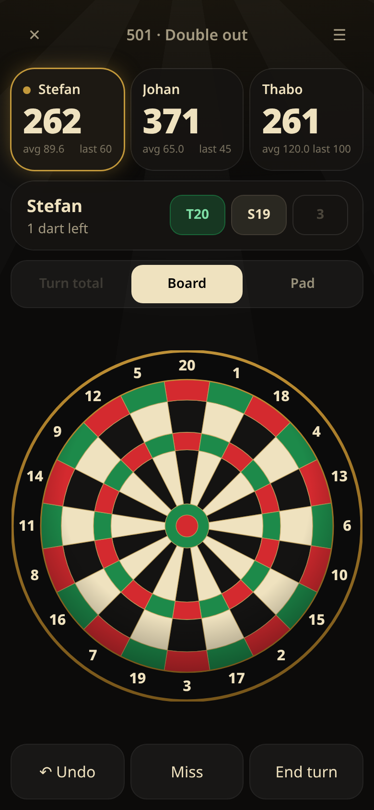

# Social Dart 🎯

A fast, mobile-first darts scorer with a real tap-the-board input. No sign-ups, no logins, no accounts and no backend: it works instantly and everything is stored on the device (localStorage). Installable as a PWA and it works offline.



## Games

| Game | Rules |
| --- | --- |
| **501 / 301** | Count down to exactly zero. Double-out is a toggle (bullseye counts as a double). Bust detection (below zero, 1 left on double-out, or finishing without a double) resets the turn. Checkout suggestions use the darts left in the turn. Shows a 3-dart average. |
| **Killer** | Each side has a number (randomised or picked, unique 1–20). Hit your own **double** to become a Killer. Killers take a life with every double of an opponent's number. A Killer who hits their own double loses a life. Lives are configurable (default 3). Last one standing wins. |
| **1 to 7** | Shanghai-style. Rounds 1–7, and only the round's number scores: single/double/triple = 1×/2×/3× the number. Highest total after round 7 wins (ties are shown as a draw). |
| **Cricket** (casual) | 15–20 and bull. Three marks close a number (triple = 3, double = 2, outer bull = 1, bullseye = 2). Extra marks score while any opponent still has it open. Win by closing everything with at least as many points as everyone else. |
| **Close Out** (casual) | A closing race with no points. The targets are 20, 19, 18, 17, 16, 15, **Doubles**, **Triples** and **Bull**, and each needs 3 marks. **Each dart counts once, and the thrower chooses where:** a triple on 15–20 is either 3 marks on that number or 1 mark on Triples, and a double on 15–20 is either 2 marks on the number or 1 mark on Doubles. A double or triple on 1–14 only counts as 1 mark on Doubles or Triples. A single on 15–20 is 1 mark, and a single on 1–14 counts for nothing. The outer bull is 1 Bull mark and the bullseye (the **Cherry**) is 2 Bull marks; it never counts as a double. Marks over 3 are ignored. When both options are open the app asks with two big buttons; if one is already closed for that player, the other is applied automatically. There's no opening double, and the first side to close all nine wins immediately. The chart shows how many hits each player has **left** per target (3/2/1, ✓ when closed) and their total targets left. |
| **Around the Clock** (casual) | Hit 1 → 20 in order (any ring counts), then the bull (25 or 50). |

**Players & teams:** add, rename, reorder, shuffle or remove players. Turn on teams (2–4): a team shares one score and its members take turns in rotation.

**Input:** X01 has a *Turn total* keypad (with a one-tap *Checkout* button), the interactive *Board* and a *Pad* grid (Single/Double/Triple + number, 25, Bull, Miss). Other games use the Board or the Pad. Undo works one dart (or one keypad total) at a time, even after a win. The app also keeps turn history, a winner screen with stats, and Rematch (the starting order rotates).

## Stack

Vite + React 19 + TypeScript + Tailwind CSS v4, vite-plugin-pwa (Workbox), and Vitest.

```bash
npm install
npm run dev       # local dev server
npm test          # vitest unit tests (game logic)
npm run build     # type-check + production build into dist/
npm run preview   # serve the build
```

## Structure

```
src/
  game/           # pure TypeScript game logic, no React or DOM (portable to native/server)
    types.ts      # Dart, Side, GameConfig, Action, TurnRecord
    engines.ts    # one engine per game: x01, killer, oneToSeven, cricket, closeOut, atc
    engine.ts     # replay(config, actions) → GameView; applyAction / undo / rematch
    checkout.ts   # X01 checkout suggestions & validity
    board.ts      # dartboard order + ring geometry
    meta.ts       # titles, killer number assignment
    *.test.ts
  platform/       # device adapters (haptics) – swap for Capacitor plugins on native
  components/     # React UI (Dartboard SVG, Keypad, Pad, Scoreboard, Setup, Game)
  storage.ts      # localStorage persistence
scripts/          # icon generation (renders the in-app board to PWA icons)
```

The game is **event-sourced**: a game is just its `GameConfig` plus a list of `Action`s (`dart`, `total`, `end`). Every view is `replay(config, actions)`, so undo is "drop the last action", persistence is one JSON blob, and the same log could later be synced to other devices or a server.

## Reliability

- **Saved data is versioned and validated** (`src/game/validate.ts`, `src/storage.ts`): data is stored as `{ v, data }`, and saves are replayed before use. Anything invalid or from an unknown version is discarded, so it can't crash the app. Saves from v1 are migrated.
- **An error boundary** shows *Reload* / *Reset app* (Reset clears Social Dart's saved data, the service worker and its caches).
- **Service worker:** `skipWaiting` + `clientsClaim` let a new version take over immediately, and navigations (index.html) are network-first so a new deploy is picked up right away. Hashed assets are precached for offline use.
- **Boot guard (inline in `index.html`):** a splash shows while loading. If a hashed asset 404s or the app hasn't mounted after 8 s, it clears the offline cache and reloads once, then offers *Reset app*.

## Deploy

Vercel picks up `vercel.json` (Vite preset, `dist/`). Or click
[Deploy to Vercel](https://vercel.com/new/clone?repository-url=https://github.com/Sgerber90/social-dart).

## Native apps (Capacitor-ready)

The build uses relative asset paths (`base: './'`), has no server routes, and `capacitor.config.json` points at `dist/`. To wrap it:

```bash
npm i @capacitor/core @capacitor/haptics && npm i -D @capacitor/cli
npx cap add ios && npx cap add android
npm run build && npx cap sync
```

Then switch `src/platform/haptics.ts` to `@capacitor/haptics` for real taptic feedback on iOS.

## Roadmap: virtual tournaments (not built yet)

1. **Domain (in `src/game/`)**: add a `tournament.ts` with `Tournament { format: 'knockout' | 'roundRobin' | 'league', entrants, fixtures[] }`. Each fixture holds a `GameConfig` and its `Action[]` log, and the existing `replay()` gives each fixture's winner. Bracket generation, seeding, byes and standings stay as pure functions, unit-tested like the engines.
2. **Local first**: run a tournament on one device (pass-the-phone), stored in localStorage/IndexedDB like games.
3. **Virtual / remote**: because games are action logs, players on different devices can each record their own legs and sync just the actions (WebRTC or a small realtime backend such as Supabase/Appwrite), optionally with anonymous share codes so there are still no accounts. The server would only replay and validate logs with the same `src/game` code.
